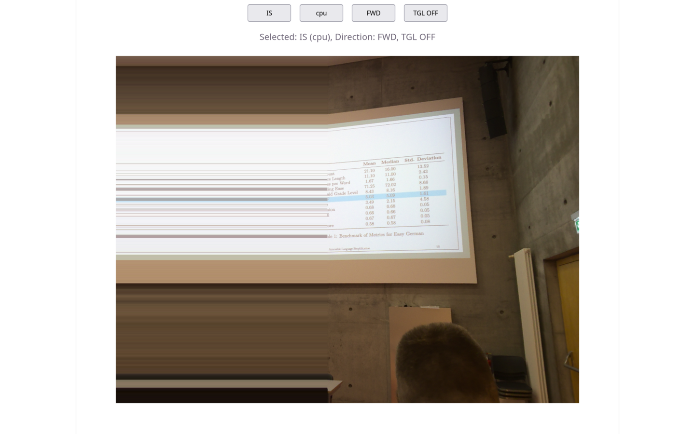

# imgsmear

Demo for "smear" like image visualization. The `ImgSmear` component sweeps a
front column across an image; pixels behind the front are replaced by the
front column's colour on their row (horizontal streaks). With a second image
(`img-b`) it becomes a photo transition: A ahead of the front, a streak band
mixing A → B at the front, B revealed behind it.



## Run the demo

```bash
npm install
npm run dev     # http://localhost:5173 (or the port vite prints)
```

Demo controls (German):

- **IS / CM** — smear component vs. colour-mix experiment
- **shader / cpu** — renderer (shader = WebGL fragment shader, cpu =
  ImageData loops; same behaviour, shader falls back to cpu when WebGL is
  unavailable)
- **FWD / BWD** — sweep direction; **TGL ON/OFF** — auto-reverse at wrap
- **1 IMG / A→B** — single-image smear vs. two-image transition
- **Bildpaar-Button** (visible in A→B mode) — cycles the image pairs
  (Wiese 2021 Sommer→Schnee, Testbilder)
- **Bandbreite** — transition band width, % of image width (2–40 %)
- **Speed** — milliseconds per front step (5–150 ms; lower = faster)

## Using the component

```vue
<ImgSmear
  :container="containerEl"
  img="/photoA.jpg"
  img-b="/photoB.jpg"      <!-- omit for the single-image smear -->
  mode="shader"            <!-- 'shader' | 'cpu' -->
  :fwd="true"              <!-- initial direction -->
  :tgl="true"              <!-- auto-reverse when the sweep wraps -->
  :delay-ms="30"           <!-- ms per front step; lower = faster -->
  :step-columns="0"        <!-- 0 = auto (~120 steps across the width) -->
  :band="0.125"            <!-- transition band, fraction of width (0..1) -->
/>
```

### Switching images

Pass different `img` / `img-b` values — the component watches both props and
reloads the bitmaps live (no remount, no `:key` bump needed). `imgB` is
stretched into `img`'s canvas geometry, so pair images with the same aspect
ratio for best results (the weekly orchard photos do). If `imgB` fails to
load, the component falls back to the single-image smear with a console
warning.

To swap images imperatively in the demo, use the Bildpaar button; in code,
just change the props.

### Speed

Two knobs combine:

- `delay-ms` — interval between front steps (default 30 ms). Live-updatable;
  both renderers pick it up without a rebuild (the CPU renderer restarts its
  tick timer).
- `step-columns` — columns advanced per step (default auto ≈ image
  width / 120). Larger steps = coarser, faster sweep.

Effective sweep duration ≈ `delayMs × width / stepColumns`.

### Band width (transition mode only)

`band` is the width of the streak band as a fraction of the image width
(default 0.125 = 1/8). It is a shader uniform in WebGL mode and a per-tick
variable in CPU mode — both update live when the prop changes. The band
carries A's colours at its edge touching the A region and B's colours at the
edge touching the revealed B (fixed in eb8ad70; the mix is
direction-invariant).

### Renderer parity

- **shader**: stateless fragment shader; the texture always holds the
  pristine image, wrap = snap the front index back. Cheap, recommended.
- **cpu**: `ImageData` loops per tick; kept as reference/fallback. Runs the
  identical band/transition logic (verified side by side).

### Known limitations

- `imgB` is stretched (not cover-fit) into A's geometry — mismatched aspect
  ratios distort B.
- The demo status line shows the `fwd` prop, not the live internal direction
  (internal auto-reverse via `tgl` is not echoed back).
